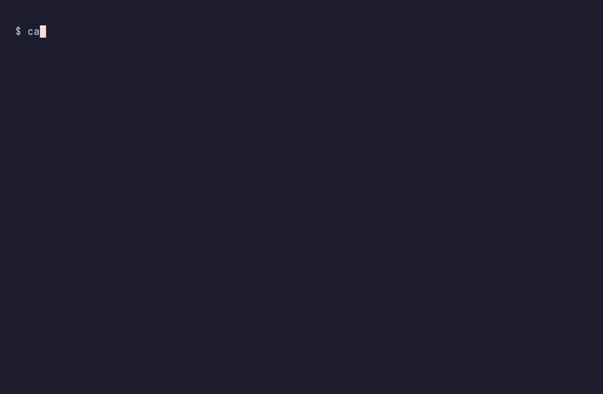
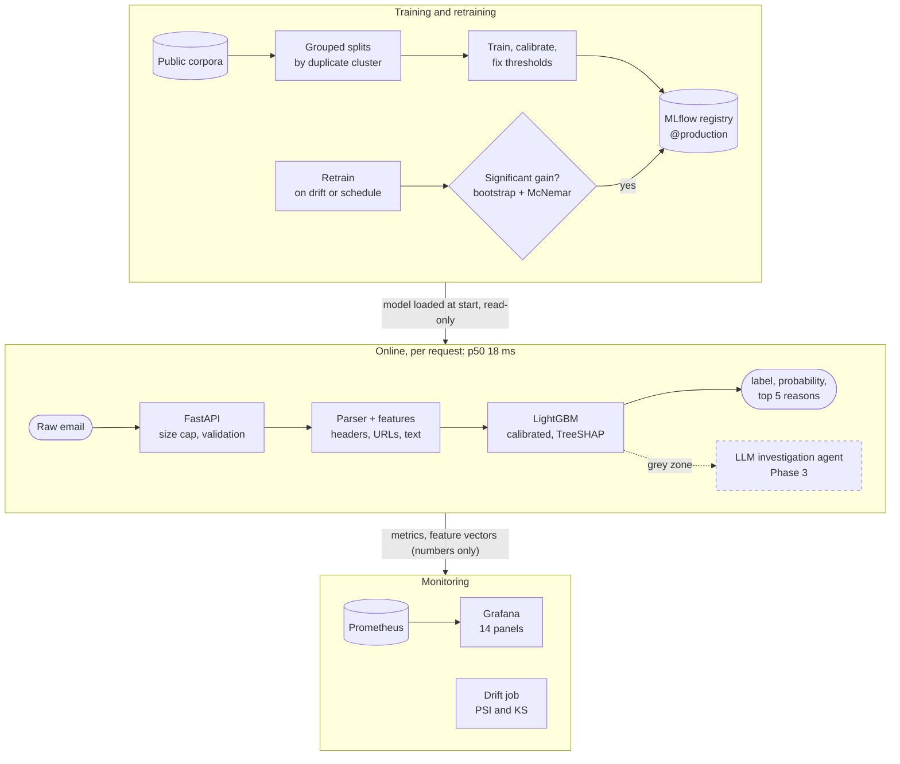
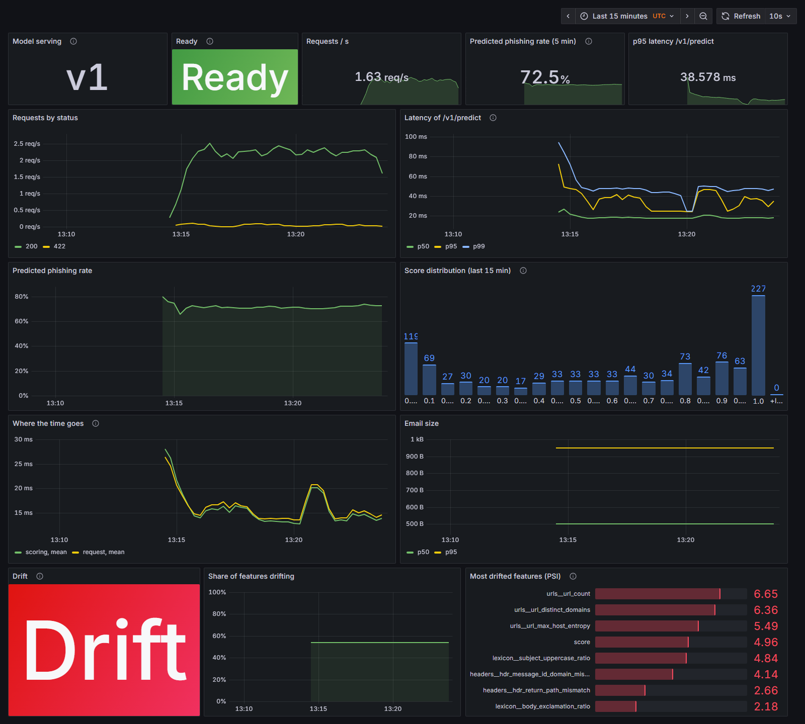

<div align="center">

# mailguard

**Phishing detection that explains every verdict, measures itself honestly and runs as a monitored service.**<br/>
An LLM agent for the grey zone comes next.

[](https://github.com/LOUONE/mailguard/actions/workflows/ci.yml)
[](https://github.com/LOUONE/mailguard/releases)
[](.python-version)
[](pyproject.toml)
[](https://github.com/astral-sh/ruff)
[](LICENSE)



<sub>Recorded with <a href="docs/demo/demo.tape">VHS</a> against the running stack, both emails made up: <code>make demo && make demo-gif</code></sub>

</div>

| **99.0%** | **18 ms** | **406** | **3** |
|:---:|:---:|:---:|:---:|
| phishing caught at 1% false alarms on ham<br/><sub>95% interval [98.1, 99.6], held-out test</sub> | median latency per email<br/><sub>p95 30 ms, ~300 req/s on 4 workers</sub> | tests, mypy strict, CI with a Docker smoke test | changes that looked better, measured, and rejected<br/><sub>with the evidence kept</sub> |

## What sets it apart

- **An evaluation that would survive review.** Splits keep near-duplicate emails together, so the
  same campaign never sits in train and test. Thresholds are fixed on validation ham, every
  figure has a 95% interval from a bootstrap over duplicate clusters, and model comparisons are
  paired (McNemar). Probabilities are calibrated and converted to a real inbox's base rate.
- **It says no to its own improvements.** A retrained model gained 0.33 points on new campaigns
  and was *not* promoted: McNemar p = 0.23 ([drift simulation](docs/drift_simulation.md)). A
  threshold rule that lifted recall to 99.4% was rejected because it would deliver 1.75% false
  alarms instead of the promised 1% ([thresholds](docs/thresholds.md)). The strongest feature of
  v0.1.0 was removed as an era marker ([ADR 0006](docs/adr/0006-drop-url-max-length.md)).
- **A service, not a notebook.** One command starts the API, MLflow registry, Prometheus, a
  14-panel Grafana dashboard, a drift job and synthetic traffic. Retraining promotes a candidate
  only behind a statistical gate ([ADR 0008](docs/adr/0008-significance-gated-promotion.md)).
- **Every verdict comes with its reasons.** The API returns the five strongest TreeSHAP
  contributions with each score, and the probability a person should see in their own mailbox.
- **Private by construction.** No email content in logs (allowlisted fields only), the drift job
  stores numbers only, the model store is mounted read-only, models are serialised without
  pickle ([ADR 0003](docs/adr/0003-model-serialisation.md)), and every port listens on localhost.

## Architecture



Components, flows and what crosses each boundary: [docs/architecture.md](docs/architecture.md).

## Results

Test split: 2,113 messages in 1,670 duplicate clusters, never used for any choice. Thresholds are
fixed on validation ham; brackets are 95% intervals from a bootstrap over duplicate clusters.
Full report: [reports/evaluation.md](reports/evaluation.md). Model card: [docs/model_card.md](docs/model_card.md).

| Baseline | PR-AUC | Recall at 1% ham FPR | Ham FPR measured on test | Recall on 2020-2025 phishing, trained up to 2019 |
|---|---|---|---|---|
| Logistic regression, text only | 0.9974 [0.9953, 0.9988] | 97.9% [96.8, 98.9] | 1.1% | **96.8% [96.0, 97.6]** |
| LightGBM, all feature groups but `url_max_length` | 0.9990 [0.9982, 0.9997] | **99.0% [98.1, 99.6]** | 1.1% | 96.1% [95.2, 97.0] |

- **Structure helps.** Header, URL and attachment features add 1.1 points of recall at 1% FPR
  (paired interval [0.4, 1.8]), and 4.0 points at the strictest threshold [2.7, 5.4].
- **New campaigns cost recall, and the text-only model holds up better.** Trained only on
  phishing up to 2019, LightGBM loses 2.7 points on 2020-2025 phishing, the logistic regression 0.9.
- **In a real mailbox, false alarms would be about as frequent as caught phishing.** Out of
  1,000 messages with 1% phishing, LightGBM would catch 9.9 of 10 phishing messages and flag
  11 legitimate ones [2, 27]. Probabilities are calibrated (ECE 0.7% on test), so a "90%" in the
  corpus is reported as 6% in such an inbox.

<details>
<summary><b>More findings from the evaluation</b></summary>

- **0.1% FPR can be neither shown nor ruled out on this data.** One test ham is 0.16% of the
  FPR; proving 0.1% would take about 3,000 ham with none flagged. The strictest threshold
  (no validation ham flagged) still flags 0.8% of test ham (5 messages).
- **The strongest v0.1.0 feature was an era marker, and it was removed.** `url_max_length`
  separated 2002 ham from later phishing ([ADR 0006](docs/adr/0006-drop-url-max-length.md),
  with an update on what the evidence turned out to show).
- **The Python version is part of the data.** A patch release of CPython decoded 4 spam messages
  differently and moved 850 of them to another split; the exact version is now pinned
  ([docs/data.md](docs/data.md#reproducibility)). LightGBM differs slightly between Linux and
  Windows, so the report is reproducible per platform.
- **Label noise does not change these figures.** 1-3% of the phishing label is wrong in a
  random sample; corrected on both sides, recall moves by about 0.3 points.
- **One split is not enough to measure a few points.** The temporal gain of ADR 0006 reversed on
  other seeds; comparisons of a few points are now repeated over split seeds
  ([mailing lists](docs/mailing_lists.md), [thresholds](docs/thresholds.md)).

</details>

## Limitations

- **The data is old.** All ham dates from 2002 and phishing from 2004 onwards, so these scores
  are an upper bound for a modern inbox ([docs/data.md](docs/data.md)).
- **Short personal mail is the likely false alarm.** 75% of training ham comes from mailing
  lists; ham without list headers is flagged 3.5% of the time against 0.2% for list mail, and up
  to two thirds of made-up personal emails on some splits. No model change fixed it without
  costing recall ([#73](docs/mailing_lists.md)): it is the job of the Phase 3 agent.
- **The 1% threshold is fragile on unlucky splits.** When copies of one legitimate email fill the
  top of the validation ranking, the threshold jumps (one split in eight lost ten points of
  recall). Measured, explained, and kept per message ([#85](docs/thresholds.md)).
- **No real traffic yet.** Everything is measured on public corpora and synthetic emails.

## Monitoring

<picture>
  <source media="(prefers-color-scheme: dark)" srcset="docs/assets/grafana-dark.png"/>
  <source media="(prefers-color-scheme: light)" srcset="docs/assets/grafana-light.png"/>
  
</picture>

The dashboard of `make demo`, fed by made-up traffic that is mostly short personal mail. **The
high predicted phishing rate and the drift alert are real findings, not demo bugs**: that traffic
looks nothing like the training ham (see Limitations), and the predicted phishing rate panel is
exactly where an operator would see such a shift. What each panel means: [docs/monitoring.md](docs/monitoring.md).

## Quickstart

### The whole system in one command

Requires Docker only (no Python, no data on the host):

```bash
git clone https://github.com/LOUONE/mailguard.git && cd mailguard
make demo        # or: docker compose up --build -d
```

| Service | URL | What it is |
|---|---|---|
| API | http://127.0.0.1:8000/docs | The scoring API and its interactive documentation |
| Grafana | http://127.0.0.1:3000 | The `mailguard` dashboard, no login |
| Prometheus | http://127.0.0.1:9090 | The metrics behind it |
| MLflow | http://127.0.0.1:5000 | Runs, registered models and the `production` alias |

The first start downloads the corpora and trains the models inside a container (about 5 minutes,
`docker compose logs -f bootstrap`); later starts take seconds. Then score an email:

```bash
cd docs/demo && ./score.sh phishing.eml     # needs curl and jq
```

<details>
<summary><b>The raw API call and response</b></summary>

```bash
curl -s http://127.0.0.1:8000/v1/predict -H 'content-type: application/json' \
  -d '{"raw": "From: PayPal <x@evil.example>\nSubject: verify your account\n\nConfirm your password now."}'
```

```json
{
  "schema_version": "v1",
  "label": "phishing",
  "score": 0.9993,
  "probability": 0.9184,
  "base_rate": 0.01,
  "model": {"name": "mailguard-lightgbm", "version": "6", "operating_point": "1pct", "threshold": 0.3622},
  "reasons": [
    {"feature": "headers__hdr_display_name_brand_mismatch", "group": "headers", "contribution": 1.91, "direction": "phishing"},
    {"feature": "lexicon__subject_credential_cues", "group": "lexicon", "contribution": 1.63, "direction": "phishing"},
    {"feature": "lexicon__body_credential_cues", "group": "lexicon", "contribution": 0.94, "direction": "phishing"},
    {"feature": "urls__url_count", "group": "urls", "contribution": -0.49, "direction": "legitimate"},
    {"feature": "text__word:list", "group": "text", "contribution": 0.47, "direction": "phishing"}
  ]
}
```

`score` is the calibrated probability at the corpus base rate, and `label` compares it with the
threshold recorded on the model version. `probability` converts the score to the share of
phishing in the mailbox (`base_rate`, 1% by default, or per request), so a client can show it to
a person. The contract is versioned (`/v1`, `schema_version`) and published as
[`docs/api/openapi.json`](docs/api/openapi.json).

</details>

### Development

Requires Python 3.14.8 (pinned, see Results) and [`uv`](https://docs.astral.sh/uv/).

```bash
make setup     # venv, dependencies, pre-commit hook
make test      # test suite with coverage (CI fails under 90%)
make lint      # ruff + mypy strict
make data      # downloads the corpora (~147 MB) into data/raw/, checksum-verified
make dataset   # parses them into data/processed/ with grouped train/val/test splits
make train     # trains both baselines (~3 min) and registers them in a local MLflow
make evaluate  # test-split report with intervals into reports/ (~3 min)
make promote   # gives the latest LightGBM the `production` alias
make serve     # scoring API on http://127.0.0.1:8000
make retrain   # trains a candidate, promotes it only on a significant gain (ADR 0008)
make simulate-drift  # holds out 2024-2025 phishing and replays drift and retraining
```

`make help` lists every target.

## Roadmap

Each phase is a [GitHub milestone](https://github.com/LOUONE/mailguard/milestones) with one issue
per task, ordered by dependency, and ends with a tagged release.

| Phase | Deliverable | Release | Status |
|---|---|---|---|
| 0 — Foundations | Repo scaffolded, CI green, `main` protected | `v0.0.1` | Released 2026-10-18 |
| 1 — Data + classical model | Parsed corpora, grouped splits, features, LightGBM baseline, rigorous eval, SHAP, MLflow | `v0.1.0` | Released 2026-10-28 |
| 2 — Production | FastAPI service, Docker, Prometheus/Grafana, drift reports, gated auto-retraining | `v0.2.0` | Released 2026-10-30 |
| 3 — Agent | LLM agent (Ollama, OpenAI-compatible fallback), typed tools, prompt-injection defence | `v0.3.0` | Next, target 2027-01-10 |
| 4 — Adversarial | Attack suite + hardening, before/after metrics | `v1.0.0` | Target 2027-01-24 |

Current board: [mailguard roadmap](https://github.com/users/LOUONE/projects/1).

## Documentation

| Topic | Where |
|---|---|
| Data, licences, leakage risks found before modelling | [docs/data.md](docs/data.md), [notebooks/01_eda.ipynb](notebooks/01_eda.ipynb) |
| Features and why each exists | [docs/features.md](docs/features.md) |
| What the model is for and where it fails | [docs/model_card.md](docs/model_card.md), [docs/error_analysis.md](docs/error_analysis.md) |
| Experiments measured and not adopted | [docs/mailing_lists.md](docs/mailing_lists.md), [docs/thresholds.md](docs/thresholds.md) |
| How it fits together | [docs/architecture.md](docs/architecture.md) |
| Latency: method, profile and the 2.4x speed-up | [docs/performance.md](docs/performance.md) |
| What it watches, and a held-out year of phishing | [docs/monitoring.md](docs/monitoring.md), [docs/drift_simulation.md](docs/drift_simulation.md) |
| Every structural decision | [Architecture decision records](docs/adr/README.md) (8) |

<details>
<summary><b>Repository layout</b></summary>

```
src/mailguard/
├── data/           corpus manifest, checksummed download, streaming loader, dedup
├── parsing/        raw email -> validated Email model
├── features/       header, URL, text features
├── models/         training, evaluation, calibration, registry, multi-seed experiments
├── serving/        FastAPI app, schemas, limits, errors, access log
├── agent/          LLM tools + investigation loop (Phase 3)
├── monitoring/     metrics, JSON logs, feature recording, drift (PSI, KS)
├── pipeline/       retraining flow, promotion gate, drift simulation
└── adversarial/    attack suite + robustness eval (Phase 4)
```

</details>

## Data

Trained and evaluated on two public corpora: ~6,000 ham and spam messages from the
[SpamAssassin public corpus](https://spamassassin.apache.org/old/publiccorpus/) and ~8,000 phishing
messages (2004-2025) from Jose Nazario's [phishing corpus](https://monkey.org/~jose/phishing/)
(CC BY 4.0). No message is redistributed in this repo; the demo emails are made up.

## License

MIT — see [LICENSE](LICENSE).
