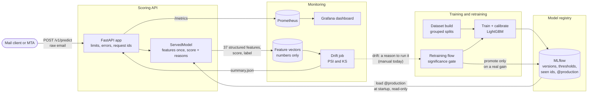

# Architecture

How the pieces of mailguard fit together after Phase 2: what runs, what talks to what, and what
crosses each boundary. Every structural choice links to the decision record that made it.

## Components

| Component | Code | What it does |
|---|---|---|
| Scoring API | [`serving/app.py`](../src/mailguard/serving/app.py) | Validates and bounds each request, scores it in a worker thread, answers with a versioned schema ([docs/api](api/openapi.json)) |
| Served model | [`serving/model.py`](../src/mailguard/serving/model.py) | Loaded once from the `production` alias; computes the features once and gets the score and its reasons from one LightGBM call ([performance](performance.md)) |
| Registry | MLflow, [`models/registry.py`](../src/mailguard/models/registry.py) | Every training run is a version, tagged with its calibrated thresholds and the ids it saw; serving follows the alias, never "latest" |
| Training | [`models/train.py`](../src/mailguard/models/train.py) | Grouped splits ([ADR 0004](adr/0004-grouped-splits.md)), LightGBM ([ADR 0005](adr/0005-model-choice.md), [0006](adr/0006-drop-url-max-length.md)), skops serialisation ([ADR 0003](adr/0003-model-serialisation.md)) |
| Retraining flow | [`pipeline/retrain.py`](../src/mailguard/pipeline/retrain.py) | Candidate against production on messages neither has seen; promotes only on a significant gain ([ADR 0008](adr/0008-significance-gated-promotion.md)) |
| Metrics | [`monitoring/metrics.py`](../src/mailguard/monitoring/metrics.py) | Traffic, latency, decisions, score distribution, model version, drift verdict ([monitoring](monitoring.md)) |
| Drift | [`monitoring/drift.py`](../src/mailguard/monitoring/drift.py), [`drift_job.py`](../src/mailguard/monitoring/drift_job.py) | Recorded feature vectors against the validation data ([ADR 0007](adr/0007-drift-without-evidently.md)) |
| Logs | [`monitoring/logs.py`](../src/mailguard/monitoring/logs.py), [`serving/access.py`](../src/mailguard/serving/access.py) | JSON lines, allowlisted fields, one access line per request |

## The four flows

**1. A request.** The body is capped while it is read (413), then validated (422, without
echoing the email). The raw message is parsed (the parser never raises,
[ADR 0002](adr/0002-parser-design.md)), turned into features once, and scored; the label compares
the calibrated score with the threshold recorded on the model version, and the probability is
converted to the mailbox base rate. Scoring has a deadline (503). The response carries the model
version and the five strongest reasons. p50 18 ms, p95 30 ms on one process.

**2. Training.** `make dataset` builds grouped splits with a reproducible hash (the Python
version is pinned: [data](data.md#reproducibility)); `make train` fits, calibrates on validation,
records thresholds and seen ids, and registers a version. Nothing is served until a version gets
the `production` alias.

**3. Monitoring.** Every response updates Prometheus counters and histograms. With feature
recording on, the 37 structured features, the score and the label of each email go to a daily
file; the drift job compares the last 2,000 with the validation data every minute and writes a
summary the API exposes as metrics. Grafana shows all of it.

**4. Retraining.** `make retrain` (or a scheduler, or a drift alert) trains a candidate and
compares it with production on test messages production has not seen. Promotion moves the alias;
the API picks it up at its next start.

## Privacy boundaries

What leaves the API process, and in what form:

| Destination | What goes there | What never does |
|---|---|---|
| Response | Score, label, probability, model version, feature names and contributions | Any part of the message |
| Logs | Request id, route template, status, timings, sizes, score, label, model version | Text, addresses, URLs, subjects, exception messages, tracebacks (allowlist, canary test) |
| Metrics | Counts, histograms, model version, PSI per feature name | Anything derived from one email |
| Feature files | 37 numbers per email, score, label, time, model version | Text, TF-IDF columns, request ids |

Model artifacts are the one place where corpus text exists outside the raw data: fitted TF-IDF
vocabularies hold n-grams. They live in the MLflow store, are mounted read-only by the API, and
are never committed or published.

## Deployment

`make demo` starts the whole system with Docker Compose: `bootstrap` (first start: download, build,
train, promote), `mlflow`, `api`, `drift`, `traffic`, `prometheus`, `grafana`. One image plays
every role: multi-stage, non-root, healthcheck on model readiness, ports bound to 127.0.0.1. CI
builds it and smoke-tests the API on a read-only model store.

The API is stateless between requests, so it scales by processes (`--workers`,
`WEB_CONCURRENCY`; about 300 requests per second with four on an 8-core desktop), each holding its
own copy of the model (370 MB resident). A production deployment would put the same image behind
a load balancer, point `MAILGUARD_MLFLOW_TRACKING_URI` at a shared tracking server, and run the
drift job and the retraining flow on a schedule.

## What is not built yet

- **The grey zone.** Uncertain scores go to an LLM investigation agent in Phase 3.
- **Hot reload of a promoted model.** The API loads the alias at startup; a promotion takes
  effect on restart (a rolling restart in a real deployment).
- **Modern legitimate mail.** The largest limitation of the model, not of the system: see the
  [model card](model_card.md#limitations).
