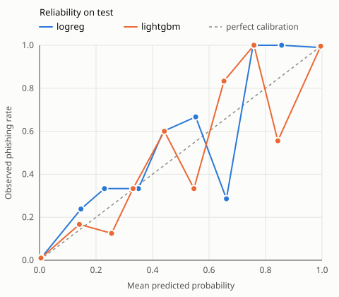

# Evaluation report

Generated by `make evaluate`. Do not edit by hand. Metrics only, no message content.

Test split: 2,113 messages (622 ham, 285 spam, 1206 phishing) in 1,670 duplicate clusters. Brackets are 95% intervals from 1000 bootstrap replicates over clusters. Thresholds are fixed on validation ham, so the test FPR is measured, not chosen.

## Operating point: 1% ham FPR on validation

| Model | Recall | Recall 2004-2007 | Recall 2015-2025 | Ham FPR | Spam FPR |
|---|---|---|---|---|---|
| lightgbm | 98.8% [97.8, 99.5] | 98.4% [96.8, 99.5] | 99.2% [98.1, 100.0] | 0.8% [0.0, 2.4] (5 msg) | 3.9% [1.5, 6.6] |
| logreg | 97.9% [96.7, 98.9] | 97.5% [95.7, 98.9] | 98.5% [97.1, 99.6] | 1.1% [0.2, 2.8] (7 msg) | 3.5% [1.5, 5.8] |

## Operating point: 0.1% ham FPR on validation

| Model | Recall | Recall 2004-2007 | Recall 2015-2025 | Ham FPR | Spam FPR |
|---|---|---|---|---|---|
| lightgbm | 96.4% [95.0, 97.6] | 96.4% [94.4, 98.0] | 96.3% [94.4, 98.0] | 0.6% [0.0, 2.0] (4 msg) | 0.4% [0.0, 1.2] |
| logreg | 94.5% [92.8, 96.0] | 93.1% [90.4, 95.4] | 96.3% [94.3, 98.0] | 0.8% [0.0, 2.4] (5 msg) | 2.5% [0.7, 4.7] |

## Ranking

| Model | PR-AUC |
|---|---|
| lightgbm | 0.9993 [0.9985, 0.9998] |
| logreg | 0.9978 [0.9960, 0.9991] |

## LightGBM minus logistic regression (paired)

PR-AUC difference: 0.0015 [0.0006, 0.0027].

| Operating point | Recall difference | Ham FPR difference | McNemar: only LR / only LGBM correct | p |
|---|---|---|---|---|
| 1% | 0.8% [0.2, 1.7] | -0.3% [-0.8, 0.0] | 9 / 20 | 0.061 |
| 0.1% | 1.8% [0.4, 3.3] | -0.2% [-0.5, 0.0] | 20 / 49 | 0.00064 |

McNemar assumes independent messages; duplicates make its p-value optimistic, so the paired cluster-bootstrap interval of the difference is the number to trust.

## Calibration

Calibrators are fitted on validation (method chosen by cross-validation grouped by cluster, on validation only) and measured here on test. ECE: mean gap between predicted and observed phishing rate over 10 equal-width bins.

| Model | Method | ECE raw | ECE calibrated | Brier raw | Brier calibrated |
|---|---|---|---|---|---|
| lightgbm | sigmoid | 1.0% [0.5, 1.8] | 0.7% [0.5, 1.6] | 0.0124 [0.0064, 0.0196] | 0.0120 [0.0063, 0.0188] |
| logreg | sigmoid | 1.6% [1.4, 2.5] | 1.0% [0.6, 1.9] | 0.0178 [0.0123, 0.0241] | 0.0172 [0.0109, 0.0246] |

Almost every score is below 0.1 or above 0.9. The bins in between hold a handful of messages each, so their zigzag is noise; the counts are in the table below.

| Model | Bin | Messages | Mean probability | Observed phishing rate |
|---|---|---|---|---|
| lightgbm | 0.0-0.1 | 873 | 0.005 | 0.008 |
| lightgbm | 0.1-0.2 | 16 | 0.138 | 0.188 |
| lightgbm | 0.2-0.3 | 8 | 0.258 | 0.375 |
| lightgbm | 0.3-0.4 | 6 | 0.343 | 0.167 |
| lightgbm | 0.4-0.5 | 3 | 0.427 | 0.333 |
| lightgbm | 0.5-0.6 | 1 | 0.547 | 1.000 |
| lightgbm | 0.6-0.7 | 4 | 0.668 | 0.750 |
| lightgbm | 0.7-0.8 | 7 | 0.752 | 0.286 |
| lightgbm | 0.8-0.9 | 11 | 0.849 | 0.636 |
| lightgbm | 0.9-1.0 | 1184 | 0.997 | 0.995 |
| logreg | 0.0-0.1 | 868 | 0.007 | 0.013 |
| logreg | 0.1-0.2 | 21 | 0.145 | 0.286 |
| logreg | 0.2-0.3 | 13 | 0.252 | 0.231 |
| logreg | 0.3-0.4 | 5 | 0.351 | 0.400 |
| logreg | 0.4-0.5 | 9 | 0.448 | 0.333 |
| logreg | 0.5-0.6 | 5 | 0.574 | 0.800 |
| logreg | 0.6-0.7 | 12 | 0.664 | 0.833 |
| logreg | 0.7-0.8 | 5 | 0.748 | 1.000 |
| logreg | 0.8-0.9 | 23 | 0.861 | 0.957 |
| logreg | 0.9-1.0 | 1152 | 0.994 | 0.990 |

## What the numbers mean in a real mailbox

The corpus is 57% phishing. Recall and FPR do not depend on that; precision and probabilities do. Precision of the 1% operating point if phishing were this share of mail:

| Model | 0.1% phishing | 0.5% phishing | 1% phishing | 5% phishing |
|---|---|---|---|---|
| lightgbm | 11.0% [4.0, 100.0] | 38.2% [17.3, 100.0] | 55.4% [29.6, 100.0] | 86.6% [68.6, 100.0] |
| logreg | 8.0% [3.4, 38.7] | 30.4% [15.0, 76.0] | 46.8% [26.2, 86.4] | 82.1% [64.9, 97.1] |

The test set holds 622 ham and the 1% threshold flags about 5 of them, so the ham FPR and every precision built on it are uncertain; an upper bound of 100% comes from replicates that drew no flagged ham at all.

A calibrated probability converted to those base rates (Bayes' rule on the odds, `mailguard.models.calibration.adjust_prior`):

| Model | Corpus probability | 0.1% | 0.5% | 1% | 5% |
|---|---|---|---|---|---|
| lightgbm | 0.5 | 0.001 | 0.004 | 0.008 | 0.038 |
| lightgbm | 0.9 | 0.007 | 0.033 | 0.064 | 0.263 |
| lightgbm | 0.99 | 0.069 | 0.272 | 0.429 | 0.797 |
| logreg | 0.5 | 0.001 | 0.004 | 0.008 | 0.038 |
| logreg | 0.9 | 0.007 | 0.033 | 0.064 | 0.263 |
| logreg | 0.99 | 0.069 | 0.272 | 0.429 | 0.797 |

## Temporal check: phishing from 2020-2025

| Model | Trained up to 2019 | Trained on the main split |
|---|---|---|
| lightgbm | 95.3% [94.1, 96.3] on 1800 msg, ham FPR 0.6% [0.0, 2.0] | 98.8% [97.3, 100.0] on 259 msg |
| logreg | 96.5% [95.6, 97.4] on 1800 msg, ham FPR 1.3% [0.2, 3.0] | 97.7% [95.6, 99.3] on 259 msg |

Both at a 1% ham FPR threshold fixed on validation. The gap is what a model loses on campaigns from years it has never seen.
